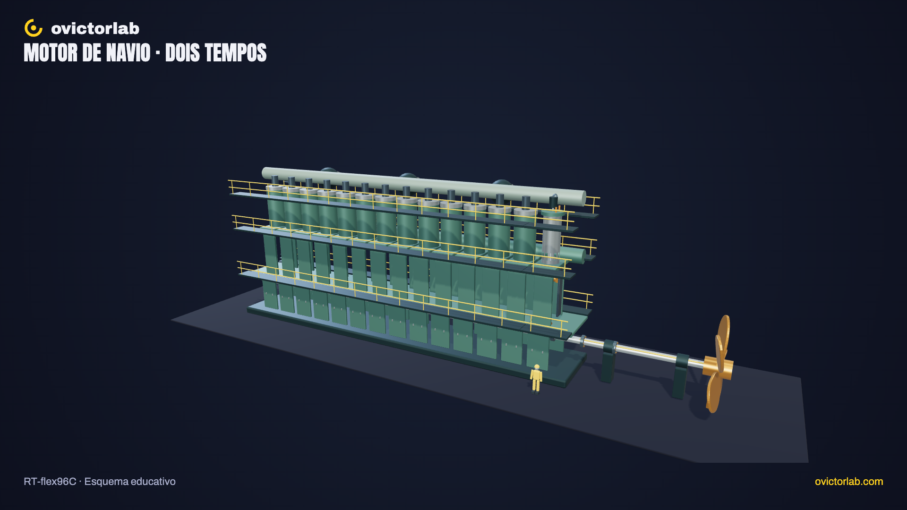

# Motor de navio gigante

**[Abrir a experiência →](https://victorsodre.github.io/motor-navio/)** · [Os 10 experimentos](docs/COLECAO.md) · [Publicação e manutenção](docs/PUBLICACAO.md)

[](https://victorsodre.github.io/motor-navio/)

Aplicação educativa 3D do **Wärtsilä RT-flex96C de 14 cilindros**: do pistão à hélice, com um cilindro em corte, cruzeta, biela e transmissão direta. Desenvolvimento concluído; aplicação estática no GitHub Pages.

## Vídeo relacionado do canal

<a href="https://www.youtube.com/watch?v=SoQtd_t-MUk"></a>

**[Por que um navio de aço não afunda? (e por que ele vira)](https://www.youtube.com/watch?v=SoQtd_t-MUk)**

O vídeo explica a flutuação e a estabilidade dos navios. O experimento complementa o tema mostrando o movimento do motor até a hélice.

O player incorporado fica [na página do experimento](https://victorsodre.github.io/motor-navio/#video), com carregamento por clique e sem reprodução automática.

## Executar

Node.js ≥22.18. Versões fixadas no lockfile.

```sh
npm ci
npm run dev
npm test
npm run check
npm run build
npm run preview
```

O build estático fica em `dist/`, com base relativa, fontes locais e licenças. Não requer backend, LLM ou GPU de produção. O WebGL usa o navegador do visitante.

## Explorar

- **Mover o motor:** ciclo de dois tempos, pausa, velocidade didática e avanço por ângulo ou etapa.
- **Abrir cilindro:** revela pistão, haste, cruzeta, biela e troca de gases; preserva o contexto do conjunto.
- **Comparar escala:** curso de 2,50 m ao lado de uma figura de 1,80 m, definida para comparação. A câmera muda; a escala dos objetos permanece.
- Seis grupos selecionáveis por catálogo/clique, busca, isolamento, foco, tour, órbita, zoom, malha, reset, tela cheia e PNG 16:9/9:16.
- Teclado: controles HTML; `R` reenquadra e `Escape` fecha detalhe/diálogo. Movimento reduzido sem autoplay; etapas continuam disponíveis.

## Limites do modelo

Um cilindro móvel e treze repetições visuais. A ficha do fabricante sustenta arquitetura, curso, diâmetro e cota longitudinal A. Demais proporções, hélice, temporização e velocidade são esquemáticos. Sem simulação de combustão, potência, consumo, hidrodinâmica ou ordem de ignição dos 14 cilindros. A referência humana é autoral, não uma média antropométrica.

## Origem e documentação

[Reel do motor](https://www.instagram.com/reel/DfVTXkqEmNA/). O [vídeo sobre flutuação](https://www.youtube.com/watch?v=SoQtd_t-MUk) é uma ligação editorial, não fonte sobre este mecanismo.

- [Apuração e fontes](docs/APURACAO.md), [escopo](docs/ESCOPO.md) e [direção visual](docs/DIRECAO-VISUAL.md).
- [Arquitetura](docs/ARQUITETURA.md), [identidade](docs/IDENTIDADE-VISUAL.md), [assets](docs/ASSETS-E-FONTES.md) e [manutenção](docs/MANUTENCAO.md).
- [Validação](docs/VALIDACAO.md): sete testes e 97 verificações no Chrome; celular emulado, sem aparelho físico.
- [Execução](docs/EXECUCAO.md), [decisões](docs/DECISOES.md) e [rascunhos do X](POSTAGENS-X.md). Nenhuma postagem enviada.

Repositório público: [victorsodre/motor-navio](https://github.com/victorsodre/motor-navio). Publicação automática no GitHub Pages; procedimento em [PUBLICACAO.md](docs/PUBLICACAO.md).
