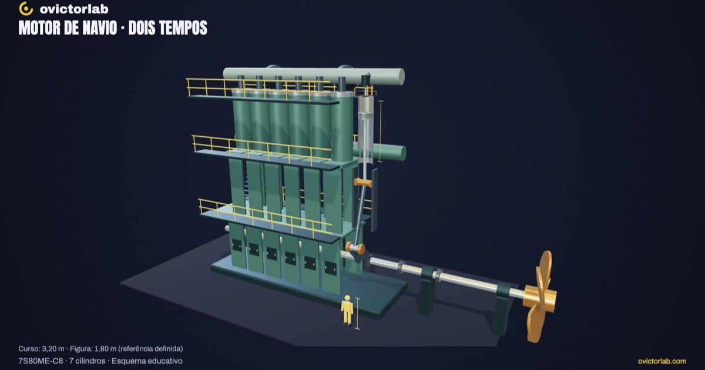

# Motor de navio gigante

**[Abrir a experiência →](https://victorsodre.github.io/motor-navio/)** · [Os 10 experimentos](docs/COLECAO.md) · [Publicação e manutenção](docs/PUBLICACAO.md)

[](https://victorsodre.github.io/motor-navio/)

Aplicação educativa 3D do motor do navio que leva minério do Brasil à China, o **MAN B&W 7S80ME-C8 de 7 cilindros** do EP341: do pistão à hélice, com um cilindro em corte, cruzeta, biela e transmissão direta. Desenvolvimento concluído; aplicação estática no GitHub Pages.

## Vídeo do canal

Até 17/11/2026 às 16h (Brasília), a página mostra o vídeo de flutuação [Por que um navio de aço não afunda?](https://www.youtube.com/watch?v=SoQtd_t-MUk), com aviso de que ele não trata do motor, e o [Reel do motor no Instagram](https://www.instagram.com/reel/DfVTXkqEmNA/). A partir daí, o Short do EP341 ([zPVEOAuuBUg](https://www.youtube.com/watch?v=zPVEOAuuBUg)) entra sozinho (`next` em `src/content/video.ts`); o workflow reconstrói o site nesse dia para o `index.html` estático acompanhar.

## Executar

Node.js ≥22.18. Versões fixadas no lockfile.

```sh
npm ci
npm run dev
npm test
npm run check
npm run build
npm run preview
```

O build estático fica em `dist/`, com base relativa, fontes locais e licenças. Não requer backend, LLM ou GPU de produção. O WebGL usa o navegador do visitante.

## Explorar

- **Mover o motor:** ciclo de dois tempos, pausa, velocidade didática (1× = 15 rpm) ou real (78 rpm), avanço por ângulo ou etapa e **Dar ré**.
- **Abrir cilindro:** revela pistão, haste, cruzeta, biela e troca de gases; preserva o contexto do conjunto.
- **Comparar escala:** curso de 3,20 m ao lado de uma figura de 1,80 m, definida para comparação. A câmera muda; a escala dos objetos permanece.
- Seis grupos selecionáveis por catálogo/clique, busca, isolamento, foco, tour, órbita, zoom, malha, reset, tela cheia e PNG 16:9/9:16.
- Teclado: controles HTML; `R` reenquadra e `Escape` fecha detalhe/diálogo. Movimento reduzido sem autoplay; etapas continuam disponíveis.

## Limites do modelo

Um cilindro móvel e seis repetições visuais. As fontes sustentam 7 cilindros, diâmetro, curso, rotação máxima (78 rpm) e cota longitudinal A (do irmão S80MC-C8). Demais proporções, hélice, temporização e velocidade são esquemáticos. Sem simulação de combustão, potência, consumo, hidrodinâmica ou ordem de ignição dos 7 cilindros. A referência humana é autoral, não uma média antropométrica.

## Origem e documentação

Origem: EP341 ([Reel do motor](https://www.instagram.com/reel/DfVTXkqEmNA/) e Short zPVEOAuuBUg).

- [Apuração e fontes](docs/APURACAO.md), [escopo](docs/ESCOPO.md) e [direção visual](docs/DIRECAO-VISUAL.md).
- [Arquitetura](docs/ARQUITETURA.md), [identidade](docs/IDENTIDADE-VISUAL.md), [assets](docs/ASSETS-E-FONTES.md) e [manutenção](docs/MANUTENCAO.md).
- [Validação](docs/VALIDACAO.md): testes automatizados e verificações em navegador; celular emulado, sem aparelho físico.
- [Execução](docs/EXECUCAO.md), [decisões](docs/DECISOES.md) e [rascunhos do X](POSTAGENS-X.md). Nenhuma postagem enviada.

Repositório público: [victorsodre/motor-navio](https://github.com/victorsodre/motor-navio). Publicação automática no GitHub Pages; procedimento em [PUBLICACAO.md](docs/PUBLICACAO.md).
